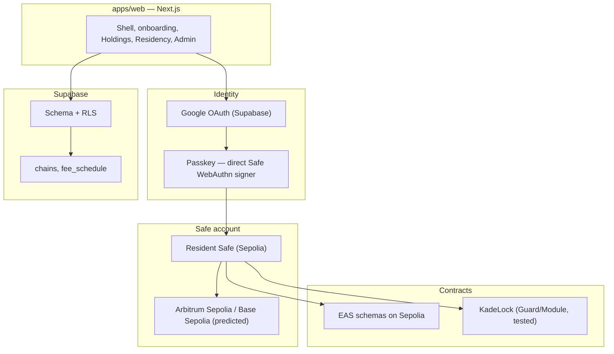

# Kade — resident platform (MVP)

Kade is the resident platform for investment-linked residency programmes. An
applicant pays a pre-approval fee onchain, holds qualifying assets in a locked
Safe vault on Ethereum, Arbitrum or Base, invests in local and tokenized
instruments, moves money through a licensed fiat partner and spends on a card.
Governments get a machine-verified queue, attested records and revenue on every
rail. First deployment: the Curaçao investor permit.

> **Status:** Week 1 foundations, **all-testnet iteration 1**. The repository is
> being built under the Colosseum Crypto World's Fair hackathon. Source code is
> in progress; this README and the frozen contract are the current source of
> truth.

## Hackathon context

| Item | Value |
|---|---|
| Event | Colosseum Crypto World's Fair (14 Sep – 12 Oct 2026) |
| Work window | Only work from 14 Sep onward is judged |
| Feature freeze | Wed 7 Oct 2026 |
| Internal upload target | Fri 9 Oct 2026 |
| Hard deadline | Mon 12 Oct 2026, 11:59 pm PT |
| Tracks | Ethereum (main), Arbitrum, Base |
| Model | Startup pitch + accelerator application, not a code contest |

## Networks and stack

- **Target chains:** Ethereum, Arbitrum, Base — same Safe address on all three.
- **Iteration 1:** Ethereum Sepolia (deploy) + Arbitrum Sepolia / Base Sepolia
  (predicted addresses). EAS schemas registered on Sepolia.
- **Stack:** Safe{Core} + ERC-4337 · Pimlico paymaster · EAS · Self (ZK passport
  identity) · USDC + Circle CCTP · Snapshot · Supabase · GOS (fiat + card) ·
  Reflect (USD vault) · Safe WebAuthn · Next.js, wagmi/viem.

## Architecture



## Repository layout (target)

```text
.
├── apps/web                     # Next.js application
├── packages/contracts           # KadeLock + attestation schemas
├── supabase/                    # migrations, RLS, seeds
├── scripts/
│   ├── verify.sh                # canonical mechanical verification
│   ├── verify-full.sh           # + expensive integration/E2E/system checks
│   └── regression/README.md     # git bisect protocol
├── tests/
│   └── regressions/             # tests protecting fixed regressions
├── docs/
│   ├── DEVELOPMENT_CONTRACT.md  # normative development contract
│   ├── VERIFY_GUIDE.md          # how verify.sh must behave
│   ├── week-1-frozen-delivery-contract.md
│   └── planning/
│       ├── kade-mvp-build-document-v7.docx
│       └── kade-mvp-backlog.xlsx
├── .opencode/
│   ├── agents/                  # orchestrator, reviewer
│   └── command/                 # /gate, /evidence
├── opencode.json
├── AGENTS.md
└── README.md
```

Application directories are created as workstreams land. `docs/`, `scripts/`,
`tests/` and `.opencode/` are present from the start.

## Week 1 scope (frozen)

Deliverables D1–D8 across packages EXE-001–EXE-006 (20 human
development/orchestration hours; agents run in parallel).

| Package | Outcome |
|---|---|
| EXE-001 | Public repo, environments, provider config, Supabase setup |
| EXE-002 | `chains` and `fee_schedule` seeded (testnet active) |
| EXE-003 | Google-only login, protected routes, transaction passkey |
| EXE-004 | Resident Safe on Ethereum Sepolia + predicted L2 addresses |
| EXE-005 | Steps 1–2 live, persisted, with server-calculated fee |
| EXE-006 | Five EAS schemas on Sepolia + tested KadeLock baseline |

**In scope:** onboarding Steps 1–2, Safe, passkey, EAS, KadeLock (tested, not
deployed), fee calculation.

**Out of scope for Week 1:** recovery, external wallet connection, payment
execution, paymaster beyond deployment, indexer, L2 Safe deployment, Aave vault,
full KYC/Self flow, admin review UI, GOS, CCTP, card, investment, voting.

See `docs/week-1-frozen-delivery-contract.md` for the full contract, gates and
acceptance evidence.

## Demo pricing

Roughly 1/1000 of production; the flow and attestations are identical. Values
live in the `fee_schedule` table (`mode` = `demo | production`).

| Function | Production | Demo |
|---|---|---|
| Pre-approval fee | `XCG 500 + XCG 100 per member` (3 → 447 USDC) | `1.00 USDC + 0.25 USDC per member` (3 → 1.75 USDC) |
| Residency service fee | `2,000 USDC` | `10 USDC` |

## Development workflow

All development is governed by `docs/DEVELOPMENT_CONTRACT.md`. The loop:

```text
known-good
    │
    ▼  granular commits
implement
    │
    ▼
./scripts/verify.sh          # mechanical gate
    │
    ▼
reviewer (adversarial)       # once per iteration, read-only
    │
    ▼
git tag -f known-good HEAD   # only after BOTH gates pass
```

Key rules:

- **commit ≠ known-good.** Intermediate commits may be granular and unreviewed.
- The reviewer compares `git diff known-good...HEAD`, not individual commits.
- Never move `known-good` while verification fails or a regression is open.
- Regression tests live in `tests/regressions/`; the bisect protocol is in
  `scripts/regression/README.md`.

## Agent harness (opencode)

- Default primary agent: **`orchestrator`** — executes the contract, enforces
  the human gates, and assembles the evidence bundle.
- **`reviewer`** subagent — the independent adversarial gate (read-only).
- Commands: `/gate <foundation|account|onchain|acceptance>` and
  `/evidence <EXE-00n>`.

Guardrails in `opencode.json` ask before `git push` and any `--broadcast` /
`cast send`. **Restart opencode** after changing agent or config files.

## Prior-work disclosure

Kade is developed for the Colosseum Crypto World's Fair. Only work performed
between 14 September and 12 October 2026 is submitted as hackathon work; earlier
prototypes and third-party components are disclosed here and attributed.

- Design reference: the Kade MVP prototype (`mvp.onchainisland.co`); its source
  is not available in this repository.
- Third-party code is attributed in the repository as it is integrated.

_This section is completed before the 9 October upload._

## Links

- Build guide: `docs/planning/kade-mvp-build-document-v7.docx`
- Backlog and 80-hour plan: `docs/planning/kade-mvp-backlog.xlsx`
- Week 1 contract: `docs/week-1-frozen-delivery-contract.md`
